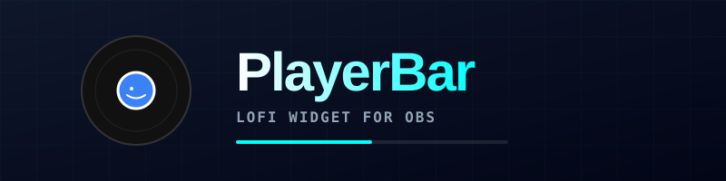

  

# 🎧 PlayerBar

**La barra de música Lofi definitiva para tus streams en OBS.**

PlayerBar es un widget de código abierto que se conecta directamente a YouTube para reproducir tus playlists favoritas (Lofi Hip Hop, NCS, etc.). Olvídate de los problemas de audio y de los reproductores pesados: solo copia el enlace, pégalo en OBS y disfruta.

🌐 **Web Oficial:** [https://playerbar.on-html.duckdns.org](https://playerbar.on-html.duckdns.org)

## ✨ Características

- **Conexión directa con YouTube:** Usa la API de IFrame para reproducir playlists.
- **Modo No-Cookie:** Usa `youtube-nocookie.com` para evitar bloqueos y problemas de privacidad.
- **Diseño Lofi:** Barra elegante con disco giratorio, título, artista y barra de progreso.
- **Auto-Ocultar:** La barra se desvanece después de unos segundos para no tapar el gameplay.
- **100% Open Source:** Código libre bajo licencia MIT. Sin anuncios ni rastreos.

## 🚀 Cómo usarlo en OBS

1. **Copia el enlace del widget:** Entra a [PlayerBar](https://playerbar.on-html.duckdns.org) y haz clic en "Copiar Link".
2. **Añade una Fuente de Navegador en OBS:** Haz clic en el `+`, selecciona "Navegador" y pega la URL.
3. **Activa el audio:** Haz clic derecho en la fuente, selecciona "Interactuar" y haz un clic dentro de la ventana. ¡La música empezará a sonar!

## 🛠️ Tecnologías

- HTML5, CSS3 y JavaScript (Vanilla).
- API de IFrame de YouTube.
- Efectos de Glassmorphism y animaciones CSS.

## 👨‍💻 Contribuir

¡Las contribuciones son bienvenidas! Si quieres añadir nuevas funciones (visualizador de audio, más playlists, temas, etc.), haz un fork y envía un Pull Request.

## 📜 Licencia

Este proyecto está bajo la Licencia MIT. Eres libre de usarlo, modificarlo y compartirlo.

---

Hecho con 🐋 por el [NEXUS HQ](https://github.com/anyelo888ra-ux).
